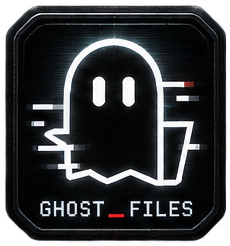

<div align="center">
  
  <h1>GHOST_FILES</h1>
  <p><strong>Компактный файловый менеджер для Windows в стиле ретро-терминала.</strong></p>
  <p>
    
    
    
  </p>
</div>

**GHOST_FILES** — небольшой файловый менеджер на Electron и обычном JavaScript. Приложение закрепляется у края экрана и предоставляет быстрый доступ к папкам, дискам и основным операциям с файлами. Интерфейс сочетает чёрно-белую терминальную эстетику, компактную панель и управление с клавиатуры.

> Основная целевая платформа — Windows 10 и Windows 11. Проект распространяется под лицензией MIT.

## Возможности

### Работа с файлами

- Просмотр папок, навигация по пути и переходы назад, вперёд и на уровень выше.
- Быстрый доступ к Desktop, Documents, Downloads, Pictures, Music и Videos — если эти папки существуют.
- Отображение доступных дисков Windows.
- Режимы отображения сеткой и списком.
- Сортировка по имени, дате изменения и размеру.
- Выделение нескольких элементов и поиск по текущему дереву каталогов с ограничением глубины и количества результатов.
- Создание папок, переименование, копирование, вырезание, вставка и перемещение.
- Перемещение удаляемых элементов в системную Корзину с подтверждением.
- Перетаскивание файлов из Проводника в GHOST_FILES и перемещение выбранных элементов на папку.
- Защита от случайной перезаписи одноимённых файлов: при копировании создаётся отдельная копия с суффиксом.
- Проверки, предотвращающие копирование или перемещение папки внутрь самой себя.

### Скрытые элементы

Кнопка `+HID` переключает отображение скрытых элементов. Учитываются имена, начинающиеся с точки, а в Windows также атрибуты `Hidden` и `System`.

### Панель, трей и панель задач Windows

- Узкая панель, закреплённая у выбранного края экрана.
- Плавное сворачивание и раскрытие.
- Глобальная горячая клавиша для показа/переключения панели.
- Значок GHOST_FILES в области уведомлений Windows (системный трей, включая меню скрытых значков).
- Обычная кнопка приложения на панели задач Windows. При наведении Windows показывает стандартную миниатюру окна; её отображение также зависит от системных настроек панели задач (в параметрах быстродействия Windows должна быть разрешена демонстрация эскизов вместо обычных значков).
- Значок приложения для окна и Windows-сборки.
- Режим «поверх остальных окон», авто-скрытие и запуск вместе с Windows для установленной сборки.
- Дополнительный визуальный эффект в стиле Matrix.

### Встроенный терминал

В приложении есть встроенная командная строка, которая выполняет команды оболочки в текущей рабочей папке. Используйте её только для команд, смысл которых понимаете.

## Скриншоты

Скриншоты интерфейса можно добавить в этот раздел после создания каталога `docs/screenshots/`. Например:

```markdown

```

## Установка готовой версии

Откройте раздел **Releases** этого GitHub-репозитория и скачайте последний установщик `.exe` для Windows. Запустите его и следуйте инструкциям мастера установки.

Сборка пока не подписана цифровым сертификатом. Поэтому Windows SmartScreen может показать предупреждение о неизвестном издателе. Это ожидаемо для неподписанного приложения; перед запуском скачивайте установщик только из доверенного релиза проекта.

## Запуск из исходного кода

### Требования

- Windows 10 или Windows 11.
- Node.js `22.12.0` или новее.
- Git — если вы клонируете репозиторий.

Проверьте версии:

```powershell
node --version
npm --version
git --version
```

### Установка и запуск

```powershell
git clone https://github.com/<YOUR_GITHUB_USERNAME>/GHOST_FILES.git
cd GHOST_FILES
npm install
npm start
```

Замените `<YOUR_GITHUB_USERNAME>` на имя своего GitHub-аккаунта и при необходимости измените адрес репозитория.

После первого `npm install` добавьте созданный `package-lock.json` в Git. Он фиксирует дерево зависимостей и позволяет другим разработчикам устанавливать одинаковые версии пакетов. Для последующих установок используйте `npm ci`.

## Проверки

Перед отправкой изменений выполните:

```powershell
npm test
npm run check
```

`npm test` запускает автоматические тесты операций с файлами. `npm run check` выполняет синтаксическую проверку JavaScript-файлов.

## Автоматическая сборка Windows через GitHub Actions

В репозитории есть workflow `.github/workflows/build-windows.yml`. Он собирает установщик на Windows runner после каждого push в `main`, а также запускается вручную.

1. Отправьте проект в GitHub командой `git push`.
2. Откройте репозиторий → **Actions** → **Build Windows installer**.
3. Дождитесь зелёного статуса завершения задания.
4. Откройте завершённый запуск и скачайте артефакт **GHOST_FILES-Windows-x64** внизу страницы.
5. Внутри папки `dist` будет установщик NSIS `.exe` и папка распакованной версии, если electron-builder сформирует её.

Артефакты GitHub Actions хранятся 14 дней. Чтобы выпустить постоянный публичный релиз, создайте Release и прикрепите к нему установщик из скачанного артефакта.

## Сборка установщика Windows

Рекомендуется собирать приложение непосредственно на Windows:

```powershell
npm install
npm test
npm run check
npm run build
```

Готовый установщик появится в каталоге `dist/`.

Альтернативно можно собрать распакованную папку приложения:

```powershell
npm run pack
```

Каталоги `node_modules/` и `dist/` не нужно загружать в GitHub. Установщики и другие собранные бинарные файлы лучше прикладывать к GitHub Release, а не хранить в истории исходного кода.

## Горячие клавиши

| Клавиши | Действие |
| --- | --- |
| `Ctrl + Alt + G` | Глобальное переключение панели |
| `Ctrl + Shift + G` / `Ctrl + Alt + F` | Резервные сочетания, если основное занято другой программой |
| `Ctrl + C` | Копировать выбранные элементы внутри приложения |
| `Ctrl + X` | Пометить выбранные элементы для перемещения |
| `Ctrl + V` | Вставить в открытую папку |
| `Ctrl + A` | Выделить все видимые элементы |
| `Ctrl + Shift + N` | Создать папку |
| `F2` | Переименовать выбранный элемент |
| `Delete` | Переместить выбранные элементы в Корзину после подтверждения |
| `Enter` | Открыть выбранный элемент |
| `Backspace` | Перейти в родительскую папку |
| `Alt + ←` / `Alt + →` | Назад / вперёд |
| `F5` | Обновить текущую папку |
| `` ` `` | Открыть или закрыть встроенный терминал |

**Важно о буфере обмена:** `Ctrl + C`, `Ctrl + X` и `Ctrl + V` работают с внутренним буфером файловых операций GHOST_FILES. Интеграция с системным буфером обмена Проводника для этих сочетаний сейчас не заявлена.

## Структура проекта

| Файл или каталог | Назначение |
| --- | --- |
| `main.js` | Главный процесс Electron, окно, системный трей, горячие клавиши и IPC-обработчики |
| `preload.js` | Ограниченный API между главным процессом и интерфейсом |
| `renderer.js` | Интерфейс и логика файлового менеджера |
| `index.html` | Разметка и стили интерфейса |
| `file-ops.js` | Проверенные операции копирования, перемещения, переименования и создания папок |
| `tests/` | Автоматические тесты файловых операций |
| `icon.ico` | Иконка окна и Windows-приложения |
| `icon.png` | Изображение для системного трея и README |
| `assets/` | Дополнительные графические ресурсы |
| `WINDOWS_RELEASE_CHECKLIST.md` | Ручной чек-лист тестирования перед релизом |
| `GITHUB_PUBLISH_RU.md` | Инструкция по публикации проекта на GitHub |

## Где хранятся настройки

Параметры приложения сохраняются в JSON-файл внутри каталога пользовательских данных Electron. Удаление этого файла сбросит настройки к значениям по умолчанию. Не добавляйте персональные настройки или содержимое пользовательских папок в репозиторий.

## Известные ограничения и безопасность

- Проект ориентирован на Windows 10/11. Работа на других ОС не является основной целью и может отличаться.
- `Ctrl + C/X/V` использует внутренний буфер приложения, а не системный буфер Проводника.
- Автозапуск через настройки Windows доступен для упакованной версии приложения; в режиме разработки он не включается.
- Установщик не подписан цифровым сертификатом, поэтому SmartScreen может предупреждать о неизвестном издателе.
- Встроенный терминал выполняет команды оболочки. Не запускайте через него неизвестные команды.
- Автоматические тесты не заменяют проверку реального приложения на Windows. Перед публикацией установщика пройдите `WINDOWS_RELEASE_CHECKLIST.md`.
- Перед операциями с важными данными рекомендуется иметь резервную копию.

### Поведение конфликтов файлов

- Если при копировании обнаружен одноимённый элемент, создаётся уникальное имя копии; исходный файл назначения не перезаписывается.
- Перемещение в занятое назначение отклоняется, исходный элемент остаётся на месте.
- Копирование или перемещение папки внутрь неё самой либо её дочерней папки запрещается.
- При перемещении между томами используется копирование, а исходник удаляется только после успешного копирования.
- Удаление выполняется через системную Корзину и требует подтверждения.

## Участие в разработке

Сообщения об ошибках и предложения по улучшению можно оформлять через **Issues**. Перед созданием Issue укажите версию Windows, шаги воспроизведения и ожидаемое/фактическое поведение. Не прикладывайте личные файлы, пароли, токены или приватные пути.

Изменения рекомендуется отправлять отдельными Pull Request. Перед отправкой запустите `npm test` и `npm run check`.

## Лицензия

Проект распространяется по лицензии **MIT**. Полный текст находится в файле [`LICENSE`](LICENSE).
